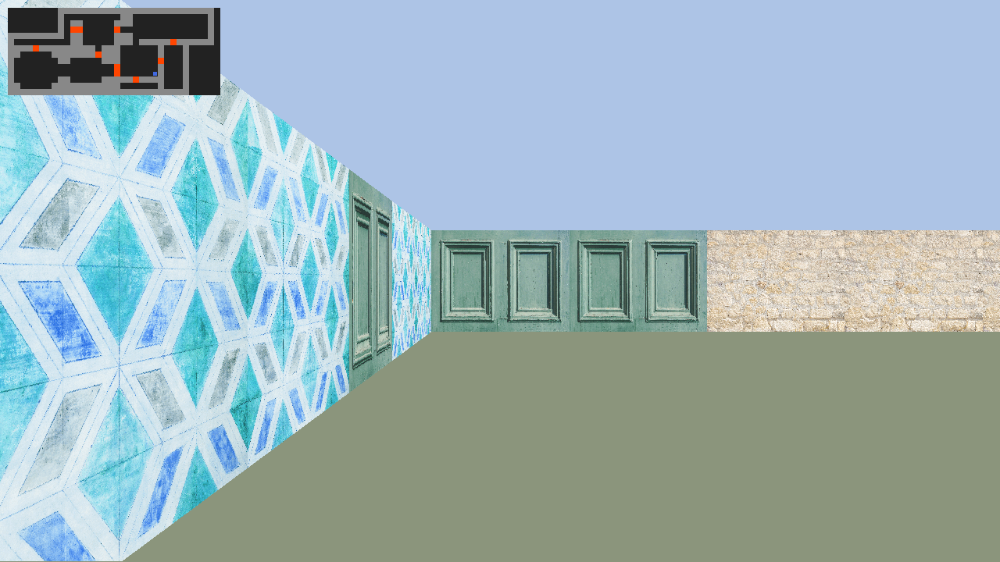

# cub3d


**A Wolfenstein-style 3D engine written from scratch in C.** The perspective is
built column by column with a DDA raycasting loop on top of MiniLibX/X11 — no
GPU, no game engine — and every level is fully validated before the first pixel
is drawn.

*Systems programming · parsing · software rendering · 3D math · memory management*



## Highlights

- **Software renderer** — per-column DDA raycasting at 1280×720, textured walls
  (N/S/E/W and doors), distance-correct wall heights, floor/ceiling colors.
- **Strict level pipeline** — `.cub` parser enforcing texture files, RGB
  ranges, a unique spawn point and flood-fill map closure; 30 malformed maps
  ship as regression fixtures.
- **Gameplay layer** — collision-aware movement, strafing, mouse look,
  openable doors that occlude both movement and rays, minimap, in-game help.
- **Memory discipline** — a small garbage collector in `libft-extended`
  centralizes cleanup, and the invalid-map suite is checked for leaks under
  Valgrind.

## Quick start

```console
$ make
$ ./cub3d maps/good/1.cub
```

Requirements: GCC or clang, GNU make, X11 development headers (`libx11-dev`,
`libxext-dev`) and a running X server. MiniLibX is vendored in `mlx/` and built
by the Makefile.

```console
$ make debug   # rebuild with -g3 -fsanitize=address,undefined
$ make help    # list all targets
```

## Controls

| Input | Action |
| --- | --- |
| `W` / `S` | Move forward / backward |
| `A` / `D` | Strafe left / right |
| `←` / `→` | Turn |
| Mouse | Look around |
| `E` | Open / close the door in front |
| `M` / `N` / `H` | Minimap / starry sky / help overlay |
| `C` | Cursor visibility |
| `Esc` | Quit |

## Level format

A `.cub` file combines texture directives (`NO`, `SO`, `WE`, `EA`, optional
`DO` for doors), colors (`F R,G,B` floor, `C R,G,B` ceiling) and an ASCII map:
`1` wall, `0` floor, `D` door, `N`/`S`/`E`/`W` spawn point and facing. The
parser rejects missing or duplicate textures, out-of-range colors, invalid
characters, map holes and missing or multiple spawns.

## Under the hood

- `src/parsing/` — file checks, texture/color parsing, map validation (allowed
  characters, single spawn, closed-map flood fill).
- `src/exec/` — game loop, raycaster, texture mapping, player physics, doors,
  minimap, star field, keyboard and mouse events.
- `libft-extended/` — libc helpers, `printf`, `get_next_line` and the garbage
  collector used across the project.

Frame flow: `check_file_valid → parse_and_validate → is_valid_map →
init_player → init_game` (MLX, textures, doors) → `mlx_loop`, with one render
pass per tick.

## Tests

- `maps/bad/` — 30 malformed fixtures across the main failure classes.
- `./test_all_bad_maps.sh` — runs every bad map under Valgrind and reports
  leaks.
- `./val.sh maps/good/1.cub` — Valgrind wrapper for a single run.

## Scope

Single-player, software-rendered walkthrough: no sprites, enemies, sound or
level editor. X11 is required (Linux, or WSL with an X server).

---
*Built at [42 Paris](https://42.fr) by [Yassmine Abdallah (@imyassmine)](https://github.com/imyassmine)
and cldalmaz.*
